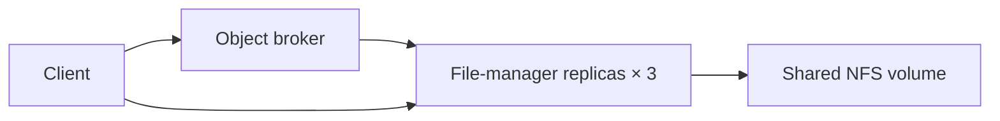

# Distributed File Service on Kubernetes

Kubernetes deployment for a file-management service with an object broker, three file-server replicas and a shared NFS volume. Distributed Systems coursework at U-tad.

The broker registers file servers and directs clients to them. The file-manager Deployment runs three replicas. All three mount the same PersistentVolumeClaim at `/app/FileManagerDir`.

## Assignment files

| File | Purpose |
| --- | --- |
| `broker-deployment-service.yaml` | One broker replica on a node labelled `role=broker`, exposed on NodePort 32002. |
| `filemanager-deployment-service.yaml` | Three file-manager replicas with a shared volume, exposed on NodePort 32001. |
| `nfs-pv-pvc.yaml` | A 10 GiB NFS PersistentVolume and a claim with ReadWriteMany access. |
| `docker-broker/` | Broker Dockerfile and Linux executable. |
| `docker-filemanager/` | File-server Dockerfile, executable and DNS configuration example. |
| `client/` | Linux client executable. |

The preceding C++ file-service project contains source code for the related broker and remote-file interface. [C++ service](https://github.com/Jorgesu040/Practica1SSDD)

## Laboratory configuration

Requires a Kubernetes cluster, a node labelled `role=broker`, a reachable NFS export, the container images named in the manifests and network access to both NodePorts.

The broker must return a file-server address that the client can reach. The file-server container discovers its external address through `api.ipify.org`. Adjust it to match your cluster's routing.

Set `NFS_SERVER_IP`, `BROKER_NODE_IP` and `DNS_SERVER_IP` for your environment. Supply `docker-filemanager/resolv.conf` when building the file-server image. The NFS export path in the saved manifest is `/exports/filemanager`.
